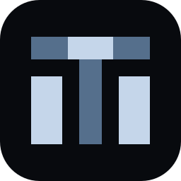

# TokenWork

**Business capital markets infrastructure — legally structured equity issuance for African SMEs.**

Built by [Foundation Stone Algorithms](https://www.foundationstonealgorithms.shop) — intelligent systems studio.

---

> **Status: planning / prototype.** This repository is in the discovery and architecture stage. Nothing here is production-ready, regulated, or a live fundraising product. Live offerings, payments, custody and legally effective issuance require jurisdiction-specific legal structuring, licensed partners and regulatory approvals. Any demonstration flows are simulated and use test data / Solana Devnet unless explicitly stated otherwise.

TokenWork enables businesses to structure and raise capital through legally defined digital financial instruments and gives investors, institutions and ecosystem partners a connected environment for discovery, participation, ownership records, servicing and reporting. Built in Uganda with African roots, designed for global markets.

- **Initial market:** Uganda
- **Initial commercial product:** Equity capital formation for SMEs
- **Stack (planned):** Rust (Axum, Tokio) · PostgreSQL · Solana (Anchor, Devnet for MVP) · TypeScript / Next.js
- **Source of truth:** [Master PRD](docs/PRD.md)

## Principles

- **Rights before tokens** — legal instrument and enforceable rights before any on-chain representation.
- **Compliance by design** — eligibility, disclosures and jurisdiction rules are product architecture.
- **AI with accountable authority** — agents assist; deterministic systems and authorized people decide.
- **No artificial liquidity** — tokenization never implies a buyer, price, redemption or exit.

## Plan

Work is tracked in [GitHub Issues](https://github.com/FoundationStoneAlgorithms/TokenWork/issues) and delivered via pull requests (`issue-<N>-<slug>` branches that close the issue). See [docs/roadmap.md](docs/roadmap.md) for the phase and milestone plan.

| Phase | Focus |
|---|---|
| 0 | Discovery and legal/market validation |
| 1 | Foundation and equity MVP (8-week Bridge milestone: 3 AI agents, 21 acceptance criteria) |
| 2 | Controlled pilot readiness |
| 3 | Instrument expansion (debt, revenue-sharing, asset-backed) |
| 4 | Institutional and ecosystem expansion |
| 5 | Capital markets expansion |

## Contributing

See [CONTRIBUTING.md](CONTRIBUTING.md). This project follows the [Contributor Covenant Code of Conduct](CODE_OF_CONDUCT.md). Security issues: [SECURITY.md](SECURITY.md).

## License

Licensed under the [Apache License 2.0](LICENSE). © 2026 Foundation Stone Algorithms.

---

